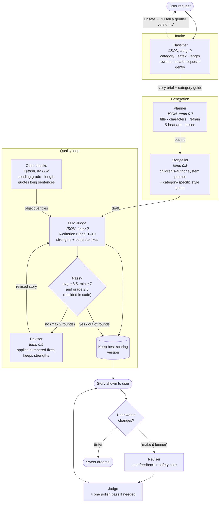

# Bedtime Story Generator (ages 5–10)

This tool turns a simple request like *"a dragon who is afraid of the dark"* into a bedtime story for ages 5–10. It runs a small multi-agent pipeline: classify, plan, write, then judge and revise in a loop. After that, the user can ask for changes.

## Quick start

```bash
pip install -r requirements.txt
export OPENAI_API_KEY=sk-...          # your own key, never committed

python main.py                         # asks for a request interactively
python main.py "A story about Alice and her cat Bob"
python main.py -v "A funny pizza"      # verbose: shows the outline, judge scores and fixes
python main.py --eval                  # runs 5 test requests and compares draft vs final judge scores
```

The model is `gpt-3.5-turbo`, as the assignment requires.

## System diagram



## How it works

| Step | Role | Why it exists |
|---|---|---|
| **1. Classifier** | Sorts the request into one of 8 categories (adventure, friendship, animals, fantasy, funny, facing fears, nature/science, calm/sleepy). Also flags unsafe requests and picks a length. | Safety is enforced before anything else runs. *"Zombies attacking a town"* becomes a gentle story instead of a refusal. The category decides which writing strategy to use. |
| **2. Planner** | Produces a JSON outline: characters, setting, a repeated **refrain**, a 5-beat arc (setup → problem → a first try that fails → a solution the hero reaches themselves → cozy ending), and a lesson. Code then cleans the outline (drops stray or empty beats). | Planning before writing gives a much better story structure than asking for prose directly. The planner can't skip the climax or end abruptly. |
| **3. Storyteller** | Writes the story from the outline, which code turns into author's notes. Its system prompt is a children's-author persona, a **category-specific style guide** (e.g. *calm_sleepy*: "each paragraph quieter than the last"), and a short sample of the target voice. | Each kind of story gets its own strategy. The higher temperature (0.8) gives more creative prose. |
| **4. Judge** | Scores 6 criteria from 1 to 10: age-appropriate, follows request, story arc, language, engagement, bedtime ending. Returns **strengths** and at most 3 **structured fixes** (`criterion`, an exact `quote` from the story, a concrete `change`). | The judge produces edit instructions, not just a grade, so its output can actually improve the story. It is told to be a strict editor (a 10 is rare), which works against LLM judges' habit of giving high scores. |
| **4b. Code checks** | Plain Python measures the Flesch-Kincaid reading grade and the word count. If the grade is too high, it **quotes the longest sentences** to split. If the story is too short, it asks for a longer middle. These fixes go first in the list. | Objective measurements the judge can't make up. GPT-3.5 is poor at judging vocabulary level and length on its own. |
| **5. Reviser** | Applies the numbered fixes while keeping the listed strengths, and is told not to shorten the story. Runs at most 2 rounds. | The cap bounds cost and latency. **The best-scoring version is kept**, so a bad revision can never make the final story worse. |
| **6. Feedback loop** | The user can type changes like "add a dragon" or "make it shorter". These go through the same reviser and judge, with a safety note attached. | The child or parent gets to shape the story without being able to steer it somewhere inappropriate. |

### Design decisions worth calling out

- **Code makes the pass/fail decision, not the LLM.** The judge only scores. A story passes when its average score is at least 8.5, no criterion is below 7, and its reading grade is 6 or lower. The minimum-score rule means a story that's very engaging but scary still fails.
- **Temperature is set per role:** 0 for the classifier and judge (consistent), 0.7 for the planner, 0.8 for the storyteller (creative), 0.5 for the reviser (targeted edits).
- **JSON mode plus a parse-and-retry fallback** makes the structured steps reliable even with GPT-3.5. Missing fields fall back to safe defaults.
- **Each agent gets its own system prompt**, so every role stays narrow and easy to debug.
- **`--eval` mode** prints a table of first-draft vs final judge scores across varied requests, including an unsafe one. It shows the judge loop's effect with numbers.

### What I changed after the first real run

My first version failed in clear ways on real GPT-3.5 output. Fixing them was the most useful part of the project:

| Observed problem | Cause | Fix |
|---|---|---|
| The story was a beat-by-beat copy of the outline, with `---` between sections, and the setting was pasted in as a sentence fragment | GPT-3.5 copies raw JSON fields into its output | The outline is turned into author's notes, the prompt bans separators and copying, and `clean_story()` strips them anyway |
| About 250 words when ~600 were asked for | GPT-3.5 can't count words | Ask for a **paragraph count**, and a code check adds an "expand the middle" fix |
| `"lesson"` ended up inside the `beats` list | Weak JSON adherence | The planner prompt is more explicit, and code validates and cleans the beats |
| The judge's fixes were vague ("enhance engagement") and repeated every round, so revisions didn't improve | Free-text fixes with no anchor | Fixes are structured objects (`criterion`, `quote`, `change`) with a good/bad example in the prompt, at most 3 per round |
| "Use simpler words" never brought the reading grade down | The instruction was too generic | Code quotes the exact longest sentences to split |
| 0 of 5 eval stories passed: GPT-3.5's ±1 noise on six scores made "all scores ≥ 8" mostly luck, and grade 5 is strict for a story read aloud | Pass rule badly calibrated | Pass rule changed to average ≥ 8.5, minimum ≥ 7, grade ≤ 6 |

**Second run** (2/5 passed, story now reads as real prose):

| Observed problem | Cause | Fix |
|---|---|---|
| Still about 350 words against a 600 target, even though the paragraph count was right | GPT-3.5's paragraphs are about 30 words long | Length targets recalibrated to what the model actually produces (medium ≈ 400 words, about 3 minutes read aloud) |
| Reading grade 8 or higher on calm and funny stories, and revisions didn't lower it | "Short sentences" is too vague | Hard numbers in the prompt: most sentences 4–12 words, none over 18, plus word swaps ("big" not "enormous") |
| The judge missed plot contradictions (meeting at the shelter *after* they already live together) and a lesson stated outright | The rubric never asked for these | `story_arc` now names these exact failure types |
| A version with better scores but a failing reading grade could be kept over a passing one | Best version chosen by score only | Versions are ranked by pass/fail first, then minimum score, then average |

## Files

- `main.py`: the pipeline, the reading-level check, the CLI, and eval mode
- `prompts.py`: every prompt, the category guides and the rubric, kept in one place so they're easy to iterate on
- `requirements.txt`: `openai>=1.0` (the skeleton's `openai.ChatCompletion` API was removed in openai 1.0, so the code uses the current client with the same model)

## Limitations and next steps

- The same model writes and judges, so the scores carry self-preference bias. A held-out evaluation judge with human-calibrated examples would be the next step.
- Flesch-Kincaid is a rough proxy that doesn't fit dialogue-heavy stories well.
- See the docstring at the top of `main.py` for what I'd build with 2 more hours.

---

<details>
<summary>Original assignment</summary>

# Hippocratic AI Coding Assignment
Welcome to the [Hippocratic AI](https://www.hippocraticai.com) coding assignment

## Instructions
The attached code is a simple python script skeleton. Your goal is to take any simple bedtime story request and use prompting to tell a story appropriate for ages 5 to 10.
- Incorporate a LLM judge to improve the quality of the story
- Provide a block diagram of the system you create that illustrates the flow of the prompts and the interaction between judge, storyteller, user, and any other components you add
- Do not change the openAI model that is being used.
- Please use your own openAI key, but do not include it in your final submission.
- Otherwise, you may change any code you like or add any files

## Rules
- This assignment is open-ended
- You may use any resources you like with the following restrictions
   - They must be resources that would be available to you if you worked here (so no other humans, no closed AIs, no unlicensed code, etc.)
   - Allowed resources include but not limited to Stack overflow, random blogs, chatGPT et al
   - You have to be able to explain how the code works, even if chatGPT wrote it
- DO NOT PUSH THE API KEY TO GITHUB. OpenAI will automatically delete it

## What does "tell a story" mean?
It should be appropriate for ages 5-10. Other than that it's up to you. Here are some ideas to help get the brain-juices flowing!
- Use story arcs to tell better stories
- Allow the user to provide feedback or request changes
- Categorize the request and use a tailored generation strategy for each category

## How will I be evaluated
- The efficacy of the system you design to create a good story
- Are you comfortable using and writing a python script
- What kinds of prompting strategies and agent design strategies do you use
- Are the stories your tool creates good?
- Can you understand and deconstruct a problem
- Can you operate in an open-ended environment
- Can you surprise us

## Other FAQs
- How long should I spend on this? No more than 2-3 hours
- Can I change what the input is? Sure
- How long should the story be? You decide

</details>
